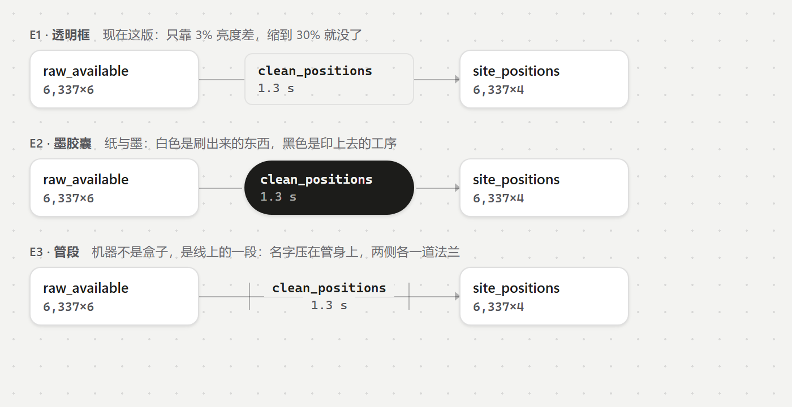
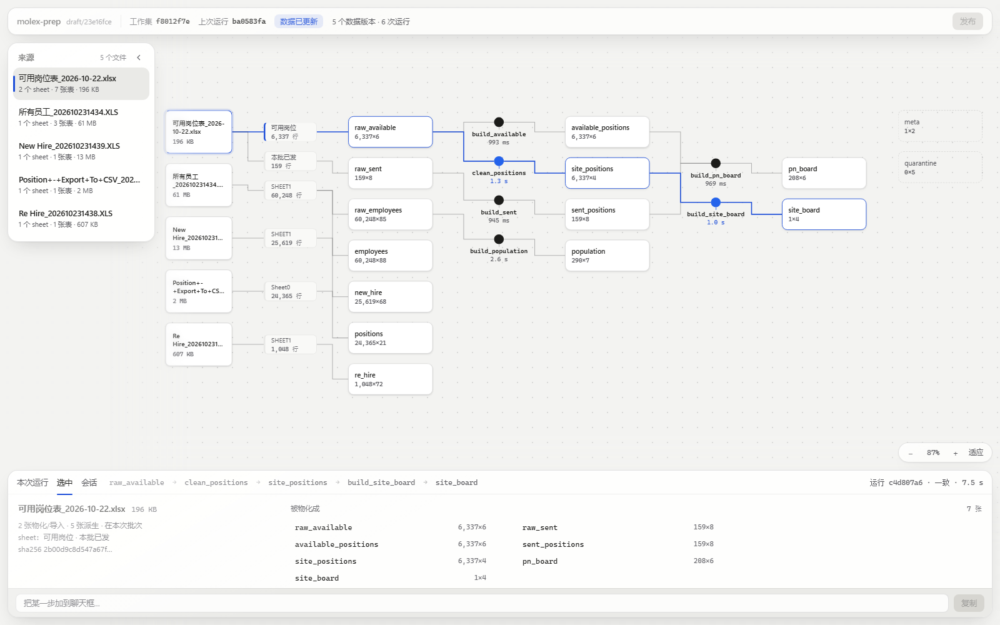

# 未定案的设计

> 这个文件只放**还没定的**东西。定案以后，要么把结论搬进 `DESIGN.md`（并在这里划掉），要么直接删条目。
>
> 每条写清四件事：**问题**、**现在是什么样**、**候选**、**推荐哪个以及为什么**。不要把没定的事写进 `DESIGN.md` 当规矩——那份文件的每一行都应该是可以直接照着实现的。

---

## P0. 画布上「产物」与「机器」的登记

状态：**未定**。样张里临时落的是 E1，代码没动。

### 问题

画布要让人**不靠图例**就看出：哪一块是产物（包括中间产物），哪一块是机器（计算节点）。

现在画布上有四类东西：

| 类 | 数量 | 是什么 |
| --- | --- | --- |
| 文件 | 5 | 源 Excel |
| sheet | 6 | 文件里的一页 |
| 表 | 15 | 物化出来的产物，含中间产物 |
| 计算 | 6 | 函数步，`file:func` |

真正的类别只有两种：**产物 = 15 张表**，**机器 = 6 个函数步**。剩下的 11 个（文件 + sheet）既不是产物也不是机器，现在跟着产物借同一张白卡——**产物的类别因此不纯**，于是永远需要解释。

### 现在实现的是 E1，它不够

E1 的编码是「数据实心白卡 / 计算透空框 + 无投影 + 全等宽」。像素上是真的：`build_sent` 框内最常见的颜色是 `#f3f3f1`，就是纸本身；`sent_positions` 框内是 `#ffffff`。

判据还是它不够格：**能测出来，不等于看得出来。** 3% 的亮度差在感知里约等于零，缩到 30%、灰度、弱对比屏全部归零。一个需要图例来教的东西，不叫编码。

### 三个候选

源码 `encodings.html` 是自包含的（只内联了这几个记号色，不依赖 `out/`），改完直接用 Chrome headless 从 `file://` 重拍：窗口 700×360，`--force-device-scale-factor=2`，产出 1400×720。

| | 明度 | 体量 | 字体 | 形状 | 判定 |
| --- | --- | --- | --- | --- | --- |
| **E1 透明框** | 差 3% | 同高 | 等宽 | 方角 7 | 出局：读成「忘了填背景的卡」 |
| **E2 墨胶囊** | 反转 | 48 高、更短 | 等宽 | 全圆 | **推荐**：四个通道同时相反 |
| **E3 管段** | 无块 | 压在线上 | 等宽 | 无 | 语义最准，但被真实数据判死 |

E3 的死因不是审美，是数据：`build_pn_board` 有 **2 个输入**（6 台机器里唯一一台）。管段一旦要收两条线，就得再发明一个汇合接头，接头本身又需要图例。

E2 的风险：黑块可能抢走产物。缓解是数量——6 台机器对 15 张产物，墨是标点不是正文。若实测太吵，退法是缩到 34 高、单行、更像标签，**不要退回 E1**。

### 第三轮：形态本身就是问题

上面三个候选都在**同一个前提**下比较：机器是一块盒子，只改填充和明度。但真正的抱怨是更前面的那层——「为什么一定要这么长条」，以及由此带来的**单调**和**拥挤**。

根因说清楚：**机器要放函数名，函数名是 13–16 个字符的等宽串。名字只要住在有边框的形状里，那个形状就必然是横的**。所以「不长条」只有两条路：

1. **把名字挪到形状外面**，形状本身缩成一个小记号（这版做的）。
2. 承认它是横的，改用别的通道拉开（就是 E2 墨胶囊）。

这一版走 1，同时把四类东西做成四种剪影：

| 类 | 剪影 | 尺寸 | 比例 |
| --- | --- | --- | --- |
| 文件 | 竖版 | 124×80 | 1.55（竖） |
| sheet | 窄夹签，左边一道 3px 竖条 | 98×36 | 2.72 |
| 表 | 横版卡 | 156×58 | 2.69 |
| 机器 | **18px 实心点骑在线上**，名字和耗时挂在点下面，中间一道 5px 引线 | 128×54 | — |

深色下点自动翻转成浅色（`--ink` 跟着主题走），规则同一条。

拥挤感同时靠三件事压下去：机器不再是盒子（少 6 个矩形）、文件竖起来（左列变窄）、列间距 46 → 58。

**这一版我不确定的一点**：那颗实心点可能被读成「标签」或「状态点」，而不是「机器」。点越实越像标记，越空越像没做完——26px 试过太重，18px 是折中。如果读错了，退路是 E2 墨胶囊：它有身体，但确实是横的。

### 待决三问

**Q1 机器用哪种编码。** E1 透明框 / E2 墨胶囊 / E3 管段。
推荐 **E2**。深色主题下 `--ink`/`--bg` 自动反转（浅底深字），规则同一条，不写特例。

**Q2 文件和 sheet 算什么。** ①第三类登记（只有左侧竖条的窄条）②移出画布、归左侧托盘，画布从表开始 ③维持现状。
推荐 **②**。原材料与产物的区分交给空间（托盘 / 画布），不再用第二种编码。代价是失去「哪份文件供了哪张表」的同屏直观性——托盘里点文件高亮下游可以补上。收益是产物这一类被彻底提纯：画布上任何一张白卡都是算出来的，任何一颗墨点都是算它的那一步。

**Q3 中间产物和最终产物要不要分级。** `raw_available` / `site_positions` 是中间，`site_board` 是最终。
推荐 **不分级**。同类同貌，一分级就要再解释一次「为什么这两个不一样」。唯一保留的降级是「没进本次运行的表」（`meta`、`quarantine`）：虚线、去投影，表示「存在但不在这一条线上」——那是时间维度的信息，和类别无关。

**Q4 形态走哪条路。** ①机器缩成线上的点、名字挂外面（第三轮的样张，已落在 `out/sep`）②机器保留身体，用 E2 墨胶囊区分 ③两者都要：点在常态，选中/运行放大成胶囊。
推荐 **①先落地，跑一次真实数据再看它读成什么**。理由是它同时解决了单调和拥挤；但这条依赖「点能不能读成机器」，所以是最需要你用眼睛判的一条。

三问都按推荐走，画布上只剩两类东西，四个通道全相反，图例就多余了。

### 定案后要动的地方

同一个界面有两份实现，必须一起改，否则立刻开始漂移：

| 文件 | 说明 |
| --- | --- |
| `out/sep/lg.css`、`out/sep/lg.js` | 设计样张（`out/` 被 gitignore，不进仓库） |
| `packages/book/app/app.css`、`app.js` | TS 侧正式实现 |
| `python-replica/src/vibe_excel/assets/book/app.css`、`app.js` | Python 侧同一份 |

后两份目前**逐字节相同**（`app.css` 12,152 字节、`app.js` 28,592 字节，哈希一致），是复制不是共享。

另外要顺带改：`DESIGN.md` §8.1（两组登记）、§8.2（尺寸表，节点尺寸一变比例表就过期）。

### 相关的既有待定

`DESIGN.md` §11 的「托盘与画布的文件列重复」和 Q2 是同一件事的两面，Q2 定了，那条一起销。
